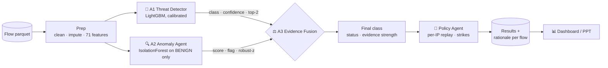
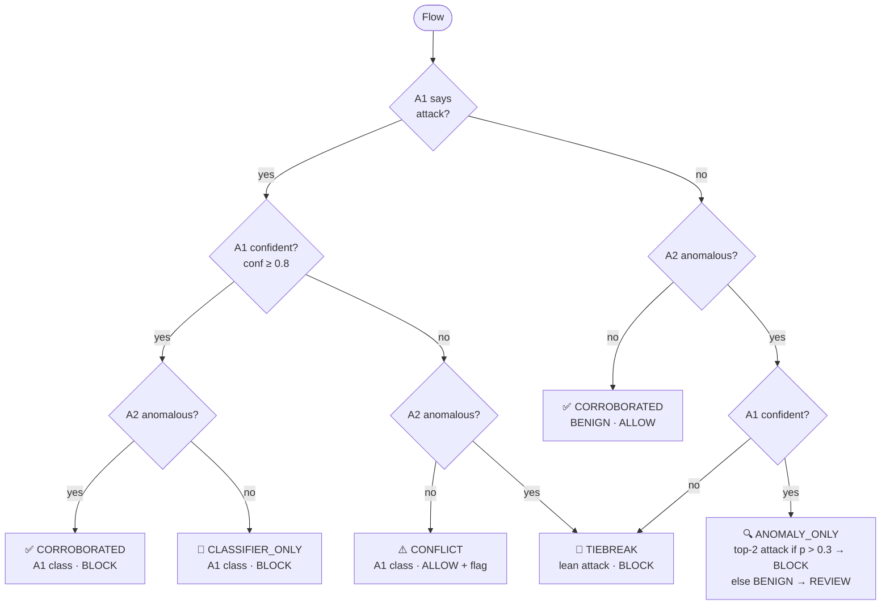
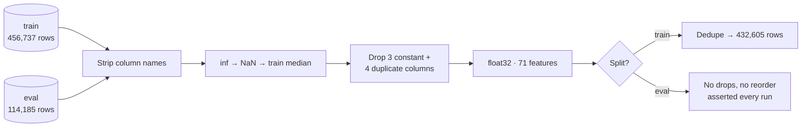
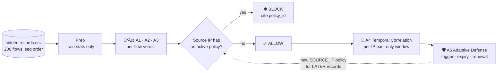

<div align="center">

# 🛡️ CyberSentinel

**Multi-agent network intrusion detection with explainable evidence fusion**

*JAI 2026 · Track 1 · CICIDS2017 offline traffic replay*


</div>

---

CyberSentinel classifies network flows into **five classes** using two independent agents:
a supervised classifier and an anomaly detector that never sees attack labels. A third agent
fuses their evidence into a final verdict, applies a simulated **ALLOW / BLOCK / REVIEW** policy,
and writes a human-readable rationale for every flow. An optional **Policy agent** replays
verdicts per source IP and blocklists repeat offenders. For Level 2, two more agents correlate
flows per source IP over time and issue expiring SOURCE_IP block policies during an ordered replay.

> Offline replay only. CyberSentinel decides what a firewall *would* do; it is not a live firewall.

| Class | Share of train |
|---|---|
| `BENIGN` | 52.6% |
| `DOS` | 21.0% |
| `DDOS` | 12.6% |
| `PORT_SCAN` | 12.6% |
| `BRUTE_FORCE` | 1.2% |

Accuracy is misleading on this class mix, so **macro-F1** is the headline metric. `BRUTE_FORCE`,
the smallest class, decides it.

## 🧭 Architecture



### The agents

| | Agent | Model | Emits |
|---|---|---|---|
| 🎯 | **A1 Threat Detector** | LightGBM, balanced class weights, isotonic calibration | `a1_class`, `a1_conf`, `a1_top2`, `a1_top2_prob`, `a1_shap` |
| 🔍 | **A2 Anomaly Agent** | IsolationForest fitted on BENIGN traffic only | `a2_score` (0-1), `a2_anomalous`, `a2_evidence` (top-3 robust-z) |
| ⚖️ | **A3 Evidence Fusion** | Transparent rule table | `final_class`, `status`, `evidence_strength`, `policy`, `rationale` |
| 🚦 | **Policy Agent** | Stateful per-source-IP replay | `replay_action`, `replay_reason`, `ip_strikes` |

A2 learns only what normal traffic looks like, so it can flag attacks A1 was never trained on.
When the agents disagree, A3 says so explicitly instead of hiding it.
The Policy Agent blocklists an IP after 3 BLOCK verdicts in its last 20 flows.

## ⚖️ How fusion decides



Each verdict carries an **evidence strength**:
`STRONG` when A1's and A2's top features overlap, `MODERATE` when the agents corroborate each other,
and `WEAK` otherwise.

Example rationale:

```text
CLASSIFIER_ONLY: A1 says DOS (0.97), A2 normal (score 0.412, top Flow Duration) -> DOS, BLOCK
```

## 🧹 Data pipeline



All statistics (medians, dropped columns, feature list) come from **train only** and are saved to
`models/prep_stats.json`, so eval and the hidden set are cleaned exactly the same way.
Endpoint metadata on the hidden set (IPs, ports, protocol, seq) passes straight through for the
policy and is never used as a model feature.

## 🚀 Quickstart

```bash
python3 -m venv .venv
.venv/bin/pip install -r requirements.txt
```

Put the organiser data in `data/Cyber/{training,eval}/flows.parquet`, then:

```bash
python scripts/inspect.py              # dataset health check
python -m src.prep                     # clean -> data/processed/
python -m src.agents.threat --train    # train + save A1
python -m src.agents.anomaly --train   # train + save A2
python -m src.agents.fusion --tune     # grid-search fusion thresholds
python -m src.pipeline --input data/processed/eval_clean.parquet --out outputs/eval_results.parquet
python -m src.eval --results outputs/eval_results.parquet   # -> outputs/metrics.json
python -m src.dashboard                # -> outputs/dashboard.html
python -m src.ppt_assets               # -> outputs/ppt/*.png
python -m src.submit                   # dry-run; --send to POST to organiser API
```

### Leave-one-attack-out experiment

```bash
python scripts/loao.py --holdout PORT_SCAN   # retrain A1 without one class, test fusion recovery
```

## 🔁 Level 2: five-agent replay

On the hidden set, two more agents turn per-flow verdicts into **time-aware source-IP policies**.
The 200 flows are replayed strictly in `seq` order. No future records or labels are used, and
A1/A2 are loaded from `models/` without retraining.



| | Agent | Logic | Emits |
|---|---|---|---|
| 🧩 | **A4 Temporal Correlation** | Per `source_ip`, groups suspicious (non-BENIGN) ALLOWed flows from the last W=20 seq positions. Past only, asserted every step. | `a4_group_id`, `a4_member_record_ids`, `a4_evidence` {count, classes, mean_a1_conf, max_a2_score} |
| 🛡️ | **A5 Adaptive Defense** | When an IP has no active policy and either A4 count ≥ 2 or the flow is an attack with `a1_conf` ≥ 0.95, it activates a SOURCE_IP policy that covers seq+1 … seq+50 (capped at the last record). Once a policy expires, a fresh trigger creates a new `policy_id`. | `a5_triggered`, `a5_policy_id`, `a5_reason`, plus activation and expiry events in `outputs/policy_log.json` |

**Replay rules.** If the source IP has an active policy, the flow is BLOCKed and A4/A5 are skipped.
Otherwise it is ALLOWed and A4 → A5 run. A flow that triggers a policy is itself ALLOWed, and the
policy applies from the next `seq` through `expires_after_record_id` inclusive. Policy fields
use `record_id` values, not seq numbers.

```bash
python -m src.prep --hidden
python -m src.pipeline --input data/processed/hidden_clean.parquet --out outputs/hidden_results.parquet --no-shap
python -m src.replay                       # -> outputs/submission/{classification,policies,replay}.csv
python scripts/validate_submission.py      # template headers + replay rules, exits 1 on any failure
```

### Hidden-set result

| | |
|---|---|
| Actions | **104 ALLOW · 96 BLOCK** |
| Policies | 4, all on `172.16.0.1` (P001–P004, renewed after each 50-seq expiry) |
| Blocked flows | **96 attack · 0 BENIGN** |
| Attacker flows let through | 4 (the policy triggers themselves) |
| Validator | all 24 checks pass |

`172.16.0.1` sends 100 of the 200 flows, and all 100 are classified as attacks
(DOS 40 · DDOS 24 · PORT_SCAN 24 · BRUTE_FORCE 12). The 13 internal `192.168.10.x` hosts are
entirely BENIGN, so no internal host is ever blocked.

## 📁 Project layout

```text
cybersentinel/
├── AGENTS.md              # agent rules & contract
├── CLAUDE.md              # (copy of AGENTS.md)
├── README.md
├── requirements.txt
├── .gitignore
├── src/
│   ├── config.py          # every path and constant (single source of truth)
│   ├── prep.py            # cleaning, train-only stats
│   ├── agents/
│   │   ├── base.py        # Agent interface: fit / predict / save / load
│   │   ├── threat.py      # 🎯 A1 — LightGBM threat detector
│   │   ├── anomaly.py     # 🔍 A2 — IsolationForest anomaly agent
│   │   ├── fusion.py      # ⚖️ A3 — evidence fusion + threshold tuning
│   │   ├── correlation.py # 🧩 A4 — temporal correlation (Level 2)
│   │   ├── defense.py     # 🛡️ A5 — adaptive defense policies (Level 2)
│   │   └── policy.py      # 🚦 per-IP replay policy (strikes & blocklist)
│   ├── pipeline.py        # A1 + A2 → A3, end to end
│   ├── replay.py          # Level 2 ordered replay → submission CSVs
│   ├── eval.py            # A1-only vs fused metrics + confusion matrices
│   ├── viz.py             # shared chart palette + inline-SVG builders
│   ├── dashboard.py       # self-contained HTML dashboard
│   ├── ppt_assets.py      # slide-ready 16:9 PNGs for presentation
│   └── submit.py          # organiser API submission (dry-run by default)
├── scripts/
│   ├── inspect.py         # dataset health check
│   ├── loao.py            # leave-one-attack-out experiment
│   └── validate_submission.py  # Level 2 submission validator
├── data/                  # gitignored, read-only except processed/
│   ├── Cyber/training/flows.parquet
│   ├── Cyber/eval/flows.parquet
│   ├── hidden/Cyber/hidden/records.csv   # Level 2 hidden set
│   └── processed/         # train_clean, eval_clean, hidden_clean .parquet
├── models/                # gitignored — saved agents + stats
│   ├── a1_lgbm.joblib, a2_iforest.joblib
│   ├── prep_stats.json, a2_baseline.json, fusion_config.json
└── outputs/               # gitignored — results + artefacts
    ├── eval_results.parquet, metrics.json
    ├── confusion_a1.png, confusion_fused.png, reliability.png
    ├── dashboard.html
    ├── ppt/               # slide-ready PNGs
    ├── submission_payload.json
    ├── hidden_results.parquet, replay_trace.parquet, policy_log.json
    └── submission/        # Level 2 classification / policies / replay CSVs
```

## 📊 Level 1 results (official eval, 114,185 flows)

Submitted on Day 1, placed 2nd on the leaderboard.

| | A1 alone | Fused (A1 + A2 → A3) |
|---|---|---|
| Accuracy | 0.999982 | 0.999982 |
| **Macro-F1** | 0.999983 | **0.999983** |
| Macro precision / recall | 0.999993 / 0.999972 | 0.999993 / 0.999972 |
| Errors | 2 (PORT_SCAN → BENIGN) | 2 (PORT_SCAN → BENIGN) |
| Eval rows unseen in train, macro-F1 | | 0.999974 |
| Throughput | | ~31–40k flows/s (full pipeline) |

| Class | F1 (fused) | A2 flag rate |
|---|---|---|
| BENIGN | 0.999983 | 2.81% |
| BRUTE_FORCE | 1.000000 | 0.07% |
| DOS | 1.000000 | 4.00% |
| DDOS | 1.000000 | 0.03% |
| PORT_SCAN | 0.999931 | 0.00% |

A2 ROC-AUC, attack vs benign, label-free: **0.897**.

### Leave-one-attack-out

`scripts/loao.py` retrains A1 without one attack class and then measures how much of that class's eval traffic is still caught.

| Held-out class | Flows | A1 detects | Fused detects | A2 flags |
|---|---|---|---|---|
| BRUTE_FORCE | 1,384 | 0.0% | 0.0% | 0.07% |
| DOS | 24,000 | 0.03% | 0.03% | 4.0% |
| DDOS | 14,400 | 62.1% | 62.1% | 0.03% |
| PORT_SCAN | 14,400 | 0.06% | 0.06% | 0.0% |

### What this shows

- **On known attacks, A1 is close to perfect.** CICIDS2017 is highly separable. Fusion neither
  helps nor hurts on eval, and every override is explained.
- **`Destination Port` is A1's strongest feature**, which is likely a shortcut.
- **Unseen attacks are the weak spot.** At the strict 97th-percentile threshold, A2 flags almost no
  attack traffic, so fusion has little independent evidence to recover a held-out class. Most of
  A2's attack scores sit at 0.48–0.55, just under the 0.565 threshold, so lowering that threshold is the
  obvious next lever.

---

<div align="center">
<sub>Built for JAI 2026 · Track 1</sub>
</div>
