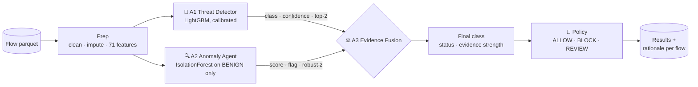
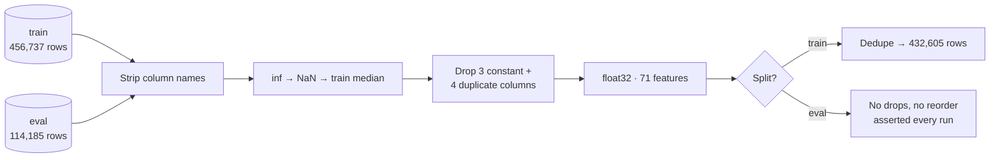

<div align="center">

# 🛡️ CyberSentinel

**Multi-agent network intrusion detection with explainable evidence fusion**

*JAI 2026 · Track 1 · CICIDS2017 offline traffic replay*


</div>

---

CyberSentinel classifies network flows into **five classes** using two independent agents:
a supervised classifier and an anomaly detector that never sees attack labels. A third agent
fuses their evidence into a final verdict, applies a simulated **ALLOW / BLOCK / REVIEW** policy,
and writes a human-readable rationale for every flow.

> Offline replay only. CyberSentinel decides what a firewall *would* do; it is not a live firewall.

| Class | Share of train |
|---|---|
| `BENIGN` | 52.6% |
| `DOS` | 21.0% |
| `DDOS` | 12.6% |
| `PORT_SCAN` | 12.6% |
| `BRUTE_FORCE` | 1.2% |

Accuracy is misleading on this class mix, so **macro-F1** is the headline metric. `BRUTE_FORCE`,
the smallest class, decides it.

## 🧭 Architecture



### The agents

| | Agent | Model | Emits |
|---|---|---|---|
| 🎯 | **A1 Threat Detector** | LightGBM, balanced class weights, isotonic calibration | `a1_class`, `a1_conf`, `a1_top2`, `a1_top2_prob`, `a1_shap` |
| 🔍 | **A2 Anomaly Agent** | IsolationForest fitted on BENIGN traffic only | `a2_score` (0-1), `a2_anomalous`, `a2_evidence` (top-3 robust-z) |
| ⚖️ | **A3 Evidence Fusion** | Transparent rule table | `final_class`, `status`, `evidence_strength`, `policy`, `rationale` |

A2 learns only what normal traffic looks like, so it can flag attacks A1 was never trained on.
When the agents disagree, A3 says so explicitly instead of hiding it.

## ⚖️ How fusion decides


Each verdict carries an **evidence strength**:
`STRONG` when A1's and A2's top features overlap, `MODERATE` when the agents corroborate each other,
and `WEAK` otherwise.

Example rationale:

```text
CLASSIFIER_ONLY: A1 says DOS (0.97), A2 normal (score 0.412, top Flow Duration) -> DOS, BLOCK
```

## 🧹 Data pipeline



All statistics (medians, dropped columns, feature list) come from **train only** and are saved to
`models/prep_stats.json`, so eval and the hidden set are cleaned exactly the same way.
Endpoint metadata on the hidden set (IPs, ports, protocol, seq) passes straight through for the
policy and is never used as a model feature.

## 🚀 Quickstart

```bash
python3 -m venv .venv
.venv/bin/pip install -r requirements.txt
```

Put the organiser data in `data/Cyber/{training,eval}/flows.parquet`, then:

```bash
python scripts/inspect.py              # dataset health check
python -m src.prep                     # clean -> data/processed/
python -m src.agents.threat --train    # train + save A1
python -m src.agents.anomaly --train   # train + save A2
python -m src.pipeline --input data/processed/eval_clean.parquet --out outputs/eval_results.parquet
python -m src.eval --results outputs/eval_results.parquet   # -> outputs/metrics.json
```

## 📁 Project layout

```text
cybersentinel/
├── src/
│   ├── config.py          # every path and constant
│   ├── prep.py            # cleaning, train-only stats
│   ├── agents/
│   │   ├── base.py        # Agent interface: fit / predict / save / load
│   │   ├── threat.py      # 🎯 A1
│   │   ├── anomaly.py     # 🔍 A2
│   │   └── fusion.py      # ⚖️ A3
│   ├── pipeline.py        # A1 + A2 → A3, end to end
│   └── eval.py            # A1-only vs fused metrics
├── scripts/inspect.py     # dataset inspection
├── models/                # saved agents + stats (gitignored)
└── outputs/               # results + metrics (gitignored)
```

## 🔬 Findings so far

- **A1 is near-perfect on eval** (accuracy 1.0000), and stays that way on eval rows that never appear in train.
  CICIDS2017 is known to be highly separable.
- **`Destination Port` is A1's strongest feature**, a likely shortcut. A leave-one-attack-out
  experiment will test how the system copes with an attack type it has never seen.
- **A2 separates attacks from benign traffic** (ROC-AUC 0.897) without ever seeing an attack label,
  but at the strict 97th-percentile threshold it flags few attacks, so most fusion decisions lean on A1.

---

<div align="center">
<sub>Built for JAI 2026 · Track 1</sub>
</div>
