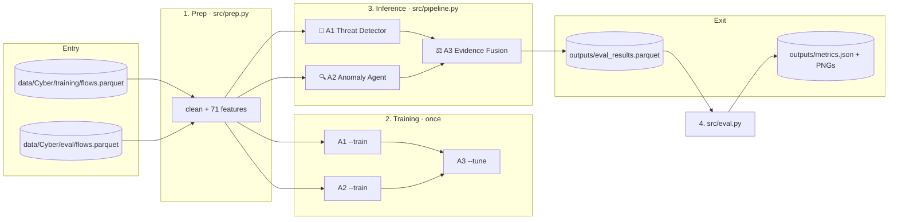
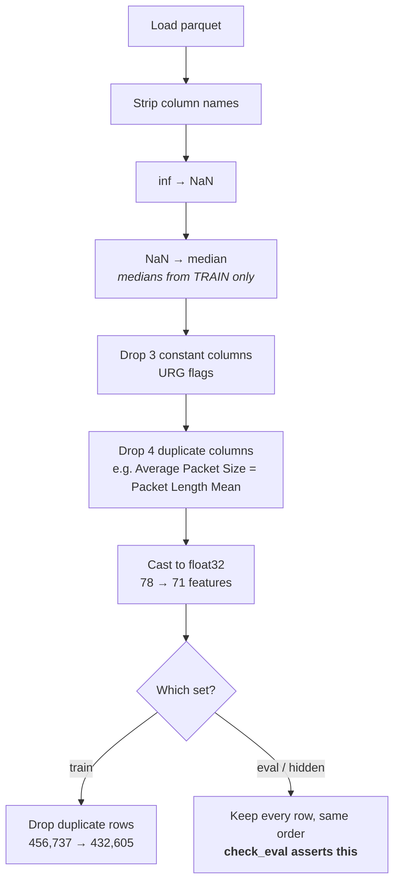
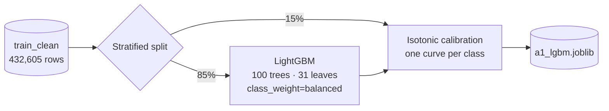
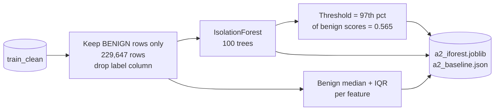
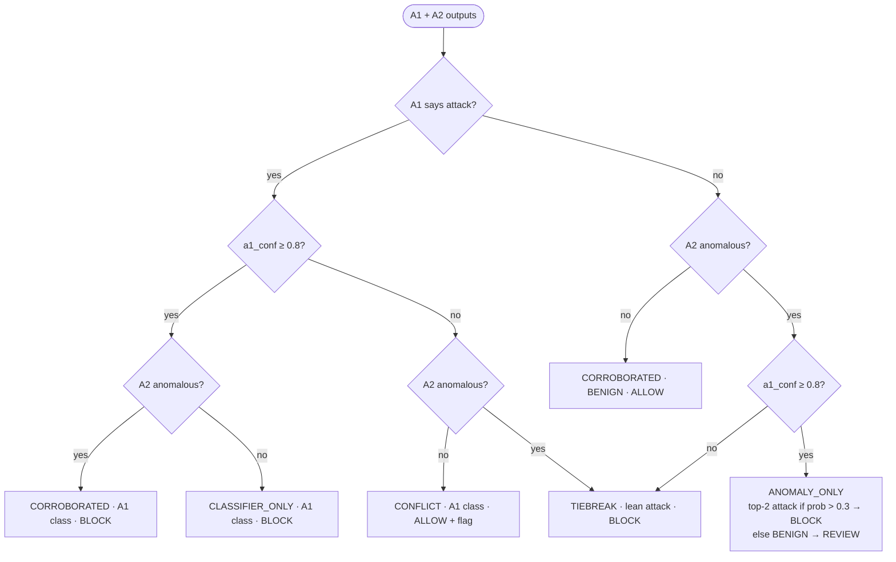
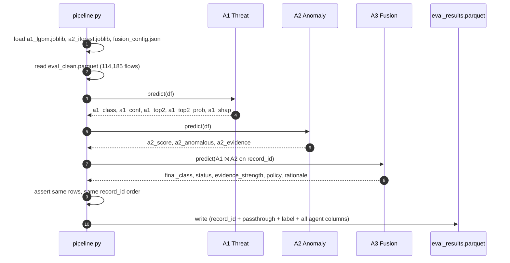

# CyberSentinel Walkthrough

How a network flow enters the system, what happens to it at each step, and what comes out.
Every file in the repo is described at the end.

---

## 1. The big picture



Four stages, each run as its own command:

| Stage | Command | Reads | Writes |
|---|---|---|---|
| 1. Prep | `python -m src.prep` | raw parquet | `data/processed/*_clean.parquet`, `models/prep_stats.json` |
| 2. Train | `python -m src.agents.threat --train`<br>`python -m src.agents.anomaly --train`<br>`python -m src.agents.fusion --tune` | `train_clean.parquet` | `models/a1_lgbm.joblib`, `models/a2_iforest.joblib`, `models/a2_baseline.json`, `models/fusion_config.json` |
| 3. Inference | `python -m src.pipeline --no-shap` | `eval_clean.parquet` + saved models | `outputs/eval_results.parquet`, `outputs/pipeline_stats.json` |
| 4. Evaluate | `python -m src.eval` | `eval_results.parquet` | `outputs/metrics.json`, `confusion_a1.png`, `confusion_fused.png` |

Training happens **once**. After that, every run loads the saved models from `models/`.

---

## 2. Entry: what a flow looks like

Each row of `flows.parquet` is one network flow (a conversation between two endpoints),
summarised by CICFlowMeter:

| Column | Example | Notes |
|---|---|---|
| `record_id` | `C022002` | Unique ID. Used for joins and output, **never a feature**. |
| 78 numeric features | `Destination Port`, `Flow Duration`, `Total Fwd Packets`, `Bwd Packets/s`, `Init_Win_bytes_backward`, ... | Packet counts, sizes, timings, flags. |
| `label` | `PORT_SCAN` | One of `BENIGN`, `BRUTE_FORCE`, `DOS`, `DDOS`, `PORT_SCAN`. |

The hidden set adds endpoint metadata (`source_ip`, `destination_ip`, ports, `protocol`, `seq`).
Those columns are **passed through untouched** for the replay policy and are never fed to a model.

---

## 3. Stage 1: Prep (`src/prep.py`)



The key rule: **every decision is made on train and replayed on eval.** Medians, the columns to
drop, and the final feature list are saved to `models/prep_stats.json`. Eval and hidden data
are cleaned with exactly those values, so nothing about eval leaks into training.

`check_eval()` runs on every prep and fails loudly if eval's row count, `record_id` order or labels change.

---

## 4. Stage 2: The three agents

All agents subclass `Agent` in `src/agents/base.py`:

```python
class Agent(ABC):
    def fit(self, df) -> Agent             # learn from data
    def predict(self, df) -> DataFrame     # one row per input row, keyed by record_id
    def save(self, path)                   # joblib
    @classmethod
    def load(cls, path) -> Agent
```

### 🎯 A1 Threat Detector (`src/agents/threat.py`)

A **supervised classifier**: it learns what each attack looks like from labelled examples.



- **LightGBM** with `class_weight="balanced"`, so the tiny `BRUTE_FORCE` class (1.2%) counts as
  much as `BENIGN` (52.6%) during training.
- **Isotonic calibration** on a held-out 15% slice of train makes `a1_conf` mean "probability
  this flow is that class", not just a raw score.
- **Evidence** (`a1_shap`): the three features that most explain the decision. True TreeSHAP was
  too slow on this machine, so it uses the plan's fallback: *global gain importance × how far
  this flow's value is from the train median* (robust z, capped at 10). `--no-shap` skips it
  and returns `[]`.

| Output | Meaning |
|---|---|
| `a1_class` | Most likely class |
| `a1_conf` | Its calibrated probability |
| `a1_top2`, `a1_top2_prob` | Runner-up class and its probability |
| `a1_shap` | `[[feature, score] × 3]` |

### 🔍 A2 Anomaly Agent (`src/agents/anomaly.py`)

An **unsupervised detector**: it only learns what *normal* traffic looks like, and flags anything
unusual. It **never sees an attack label**, so in principle it can catch attack types A1 was never trained on.



- **IsolationForest** isolates points with random splits. Unusual points get isolated quickly,
  so they get a high anomaly score.
- `a2_score` is the forest's anomaly score s(x), already in 0–1 (higher = more anomalous).
- A flow is `a2_anomalous` if its score is above the 97th percentile of benign training traffic,
  so about 3% of normal traffic is flagged by design.
- **Evidence** (`a2_evidence`): the three features with the largest robust z-score,
  `(value − benign median) / benign IQR`, i.e. "how un-normal is this feature?".

| Output | Meaning |
|---|---|
| `a2_score` | 0–1 anomaly score |
| `a2_anomalous` | `score > threshold` |
| `a2_evidence` | `[[feature, robust_z] × 3]` |

### ⚖️ A3 Evidence Fusion (`src/agents/fusion.py`)

A **transparent rule table** that combines A1's opinion with A2's. No learning; just thresholds.



| Output | Meaning |
|---|---|
| `final_class` | The system's verdict |
| `status` | Which rule fired (how the agents agreed or disagreed) |
| `evidence_strength` | `STRONG` if A1's and A2's evidence share a feature, `MODERATE` if the agents corroborate, else `WEAK` |
| `policy` | Simulated firewall action: `ALLOW`, `BLOCK`, `REVIEW` |
| `rationale` | Human-readable template string |

`--tune` grid-searches 150 combinations of `conf_t × top2_t × anomaly percentile` for macro-F1
on A1's 15% calibration slice of **train** (never eval), and saves the winner to
`models/fusion_config.json`. All 150 scored the same, so the defaults (0.8 / 0.3 / 97) were kept.

---

## 5. Stage 3: One flow, end to end (`src/pipeline.py`)



A real example from eval:

| Step | Value |
|---|---|
| Input | `record_id=C022002`, true label `PORT_SCAN` |
| A1 | `a1_class=PORT_SCAN`, `a1_conf=1.0`, `a1_top2=BENIGN` |
| A2 | `a2_score` below 0.565 → `a2_anomalous=False` |
| A3 rule | attack + high confidence + normal → **CLASSIFIER_ONLY** |
| Output | `final_class=PORT_SCAN`, `policy=BLOCK`, `evidence_strength=WEAK` |
| Rationale | `CLASSIFIER_ONLY: A1 says PORT_SCAN (1.00), A2 normal (score 0.4xx, top ...) -> PORT_SCAN, BLOCK` |

The pipeline processes the full eval set in ~3–5 s (26k–42k flows/s).

---

## 6. Exit: what comes out

### `outputs/eval_results.parquet`
One row per input flow, **same order as input**:

```text
record_id | [source_ip, destination_ip, ports, protocol, seq]* | label
| a1_class a1_conf a1_top2 a1_top2_prob a1_shap
| a2_score a2_anomalous a2_evidence
| final_class status evidence_strength policy rationale
```
`*` hidden set only. `a1_shap` and `a2_evidence` are stored as JSON strings (parquet can't hold
mixed `[str, float]` lists).

### `outputs/metrics.json` (from `src/eval.py`)

| Key | What it answers |
|---|---|
| `all.a1` vs `all.fused` | Accuracy, macro-F1, per-class F1: does fusion beat A1 alone? |
| `unseen_in_train` | Same, on the 104,390 eval rows with no exact copy in train |
| `agreement_rate`, `override_count`, `override_accuracy` | How often fusion changed A1's answer, and whether it was right |
| `confusion` | Confusion matrices (also drawn to `confusion_a1.png`, `confusion_fused.png`) |
| `status_counts`, `status_by_class` | Which fusion rules fire, per true class |
| `evidence_strength_counts`, `policy_counts` | Distribution of strength and actions |
| `a2.roc_auc_attack_vs_benign`, `a2.flag_rate_per_class` | How well A2 separates attacks without labels |
| `throughput` | Flows per second for the full pipeline |

### `outputs/loao_<CLASS>.json` (from `scripts/loao.py`)
Leave-one-attack-out: A1 is retrained **without** one attack class, and we check whether the
system still catches that class on eval.

---

## 7. Current results

| | Accuracy | Macro-F1 |
|---|---|---|
| A1 alone | 0.999982 | 0.999983 |
| Fused | 0.999982 | 0.999983 |
| Fused, rows unseen in train | 0.999981 | 0.999974 |

**What this means, honestly:**
- CICIDS2017 is close to perfectly separable, and A1 alone gets nearly everything right. The only
  errors are 2 `PORT_SCAN` flows called `BENIGN`.
- Fusion currently changes **zero** decisions. Its value on eval is the explanation (status,
  evidence, rationale), not extra accuracy.
- **LOAO shows the real weakness:** an attack type A1 never trained on is mostly called `BENIGN`
  (BRUTE_FORCE 0%, DOS 0.03%, PORT_SCAN 0.06% detected; DDOS 62%, mislabelled as `PORT_SCAN`).
  A2 should catch these, but at the strict 97th-percentile threshold it flags almost none of
  them (4% of DOS, ~0% otherwise).
- `Destination Port` is A1's top feature, a likely shortcut.

---

## 8. What each file does

### Top level
| File | Purpose |
|---|---|
| `README.md` | Project overview with architecture diagrams |
| `CLAUDE.md` / `AGENTS.md` | Project rules for AI coding assistants (`AGENTS.md` is a copy) |
| `Plan.md` | Day 1 task list; one checkbox = one commit |
| `requirements.txt` | Python dependencies |
| `.gitignore` | Keeps `data/`, `models/`, `outputs/`, `.venv/` out of git |

### `src/`
| File | Purpose |
|---|---|
| `config.py` | **Single source of truth**: every path, `CLASSES`, `RANDOM_STATE=42`, `ID_COL`, `LABEL_COL` |
| `prep.py` | Cleaning. `load` → `fit_stats` (train only) → `transform` → `dedupe_train` → `check_eval` |
| `pipeline.py` | Loads saved agents, runs A1 + A2 → A3, writes results. `run()` is reused by `loao.py` |
| `eval.py` | Computes everything in `metrics.json` and draws the confusion matrices |
| `submit.py` | *Stub.* Will send the Level 1 summary to the organiser API |

### `src/agents/`
| File | Purpose |
|---|---|
| `base.py` | Abstract `Agent`: `fit`, `predict`, `save`, `load` |
| `threat.py` | 🎯 A1: LightGBM + isotonic calibration + per-flow evidence. CLI: `--train`, `--no-shap` |
| `anomaly.py` | 🔍 A2: IsolationForest on BENIGN only + robust-z evidence. CLI: `--train` |
| `fusion.py` | ⚖️ A3: rule table (`decide`), rationale (`predict`), threshold search. CLI: `--tune` |

### `scripts/`
| File | Purpose |
|---|---|
| `inspect.py` | Dataset health check: shape, labels, inf/NaN, constant and duplicate columns, duplicate rows |
| `loao.py` | Leave-one-attack-out experiment. `--holdout PORT_SCAN` or `--holdout ALL` |

Both scripts remove `scripts/` from `sys.path` on startup, because `scripts/inspect.py` would
otherwise shadow Python's built-in `inspect` module and break numpy/pandas imports.

### `models/` (gitignored, created by training)
| File | Created by | Contents |
|---|---|---|
| `prep_stats.json` | prep | Medians, dropped columns, final feature list, row counts |
| `a1_lgbm.joblib` | A1 `--train` | Fitted A1 (LightGBM + calibrators + evidence stats) |
| `a2_iforest.joblib` | A2 `--train` | Fitted A2 (IsolationForest + benign median/IQR + threshold) |
| `a2_baseline.json` | A2 `--train` | Human-readable copy of A2's threshold and benign baseline |
| `fusion_config.json` | A3 `--tune` | Chosen thresholds and the tuning scores |

### `outputs/` (gitignored, created by runs)
| File | Created by |
|---|---|
| `eval_results.parquet` | pipeline |
| `pipeline_stats.json` | pipeline (throughput) |
| `metrics.json`, `confusion_a1.png`, `confusion_fused.png` | eval |
| `loao_<CLASS>.json` | loao |

### `docs/`
| File | Purpose |
|---|---|
| `walkthrough.md` | This document |
| `progress.md` | Build log: 2 lines per commit |
| `level2.md` | Level 2 briefing notes (to fill in) |

---

## 9. Reproduce everything from scratch

```bash
python3 -m venv .venv && .venv/bin/pip install -r requirements.txt
.venv/bin/python scripts/inspect.py
.venv/bin/python -m src.prep
.venv/bin/python -m src.agents.threat --train --no-shap   # ~1–4 min
.venv/bin/python -m src.agents.anomaly --train            # ~5 s
.venv/bin/python -m src.agents.fusion --tune              # ~35 s
.venv/bin/python -m src.pipeline --no-shap
.venv/bin/python -m src.eval
.venv/bin/python scripts/loao.py --holdout ALL            # ~4 A1 retrains
```
